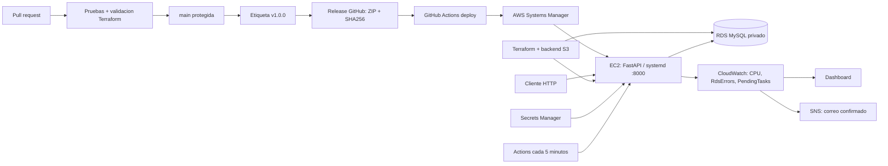

# To-Do List API - Practica 4

**David Valdez Martinez | Desarrollo en la nube | 19 de noviembre de 2026**

Entrega verificada: **17 pruebas**, main protegida, release **v1.0.0**, deploy por
SSM, fallo real de RDS con alarma ALARM y recuperacion de las cinco tareas.
Los seis workflows tienen ejecuciones exitosas. Al cerrar la validacion se
destruyeron los recursos de la aplicacion y se conservo el backend remoto.

- [Reporte PDF: dos paginas de contenido mas anexos](output/pdf/reporte-practica4-david-valdez.pdf)
- [Evidencias y enlaces de GitHub Actions](evidence/README.md)
- [Release v1.0.0 y artefacto ZIP](https://github.com/davidvaldezm/to-do-list-api/releases/tag/v1.0.0)

API FastAPI que persiste tareas en MySQL/RDS. Terraform crea EC2, Security Groups,
Key Pair, RDS, Secrets Manager, SNS, tres alarmas y un dashboard de CloudWatch.
GitHub Actions prueba, provisiona, publica releases, despliega y consulta `/health`.

## Arquitectura



La EC2 usa `LabInstanceProfile`, IMDSv2 y `user_data` para clonar este repositorio,
crear un entorno Python e iniciar systemd sin SSH ni scp. El Key Pair existe por
requisito, pero el puerto 22 permanece cerrado. El unico puerto publico de la app
es 8000 (demostracion sin autenticacion; usar solo datos de prueba).
RDS no es publico: solo acepta 3306 desde el Security Group de la API.
La conexion MySQL usa TLS con verificacion del certificado de RDS.

## Desarrollo y pruebas

Requiere Python 3.11+, Git, AWS CLI y Terraform >=1.10. Las versiones exactas
de Python se fijan en los workflows y las librerias en requirements.

```bash
python -m venv .venv
source .venv/bin/activate   # Windows: .venv\Scripts\Activate.ps1
pip install -r requirements-dev.txt
pytest -v
ruff check src tests scripts
```

Las pruebas usan un repositorio simulado y clientes AWS simulados; no necesitan
AWS ni una base de datos. Para ejecutar la app real, configura un secret JSON
con `host`, `port`, `dbname`, `username`, `password`, accesible para tu rol AWS:

```bash
export AWS_REGION=us-east-1
export DB_SECRET_ARN='arn:aws:secretsmanager:us-east-1:CUENTA:secret:...'
export RDS_CA_BUNDLE='/ruta/global-bundle.pem'
export CLOUDWATCH_ENABLED=true
uvicorn src.main:app --host 0.0.0.0 --port 8000
```

Las credenciales se leen de Secrets Manager al abrir una conexion y se cachean
como maximo cinco minutos. Nunca se incluyen contrasenas en codigo o user_data.

## Configuracion de GitHub y Learner Lab

Repositorio publico para que EC2 pueda clonar codigo y descargar releases sin
guardar tokens GitHub en la instancia. Configura en Settings > Secrets and
variables > Actions:

| Tipo | Nombre | Contenido |
|---|---|---|
| Secret | `AWS_ACCESS_KEY_ID` | Clave temporal del Learner Lab |
| Secret | `AWS_SECRET_ACCESS_KEY` | Secreto temporal |
| Secret | `AWS_SESSION_TOKEN` | Token de la misma sesion |
| Variable | `TF_STATE_BUCKET` | Nombre del bucket creado abajo |
| Variable | `NOTIFICATION_EMAIL` | Correo que confirmara SNS |

No se crea un usuario IAM permanente: Learner Lab limita IAM y proporciona
`LabInstanceProfile`. Al renovar una sesion actualiza **los tres** secrets AWS.
Los workflows programados fallaran si caducan las credenciales o se detiene EC2.
El cron solicita ejecucion cada cinco minutos; GitHub puede retrasarlo.
Provision reactiva el workflow de salud tras verificar la aplicacion. Destroy
lo desactiva despues de eliminar los recursos, para evitar alertas y ejecuciones
fallidas sobre una infraestructura que se apago deliberadamente.

Proteccion de `main`: requerir pull request y los checks `Unit tests` y
`Terraform validation`, con la rama al dia y sin bypass de administradores.
Un check fallido bloquea el merge. No se exigen revisores adicionales porque
la entrega es individual. Settings > Branches muestra la configuracion.

## Backend remoto: bootstrap con Terraform

El bucket tambien se provisiona con Terraform, en un root separado para que
destruir la aplicacion conserve el historial del tfstate. Usa un nombre unico:

El root bootstrap usa `aws_cloudformation_stack` con un recurso S3: Learner Lab
bloquea `GetBucketObjectLockConfiguration`, una lectura del recurso directo
`aws_s3_bucket`. La pila sigue declarada, creada y administrada por Terraform;
el bucket tiene `DeletionPolicy=Retain` y la pila `prevent_destroy`.

**El workflow Provision infrastructure hace este bootstrap y migra su estado
automaticamente si el bucket aun no existe.** Los comandos siguientes son la
alternativa local y explican el procedimiento reproducible.

```bash
export AWS_DEFAULT_REGION=us-east-1
export BUCKET=todo-dvm-p4-tfstate-CUENTA-us-east-1
terraform -chdir=terraform/bootstrap init
terraform -chdir=terraform/bootstrap apply -var="state_bucket=$BUCKET"
```

Crea `terraform/bootstrap/backend.generated.tf` con:

```hcl
terraform {
  backend "s3" {}
}
```

Crea `terraform/bootstrap/backend.hcl` con los campos de
`terraform/backend.hcl.example`, cambiando `bucket` y usando
`key = "bootstrap/terraform.tfstate"`. Migra:

```bash
terraform -chdir=terraform/bootstrap init -migrate-state -backend-config=backend.hcl
```

El estado inicial local solo se usa para crear el bucket y se migra inmediatamente
a S3. Ambos estados remotos tienen versionado, cifrado y bloqueo nativo S3
(`use_lockfile=true`); el bucket bloquea todo acceso publico y tiene
`prevent_destroy`. Nunca subas estados, planes, credenciales o llaves privadas.
El tfstate contiene informacion sensible, incluida la contrasena generada y la
llave privada; solo debe estar en el backend privado. No se publica como artifact.

## Provisionar y destruir

En Actions ejecuta **Provision infrastructure > Run workflow**. Todo lo que
crea AWS lo declara Terraform; los scripts de user_data configuran el sistema
operativo de EC2 y arrancan la app. El workflow espera `/health` y guarda outputs
sin contrasenas. La primera creacion de RDS tarda varios minutos.

Para ejecutar lo mismo localmente:

```bash
cp terraform/backend.hcl.example terraform/backend.hcl
# Edita bucket con el nombre real.
terraform -chdir=terraform init -backend-config=backend.hcl
terraform -chdir=terraform apply -var='notification_email=tu-correo@example.com'
terraform -chdir=terraform output
```

Confirma el enlace enviado por **AWS Notifications / SNS** al correo configurado.
Hasta confirmarlo, SNS deja la suscripcion en `PendingConfirmation`.

Para eliminar los recursos de esta practica ejecuta **Destroy infrastructure**
con `confirmation=DESTROY`. RDS se elimina sin snapshot final y se pierden sus
tareas. El bucket de estado permanece y no se modifica infraestructura ajena.
Equivalente local:

```bash
terraform -chdir=terraform destroy -var='notification_email=tu-correo@example.com'
```

## API y persistencia

```bash
BASE=http://IP_EC2:8000
curl -X POST "$BASE/tasks" -H 'Content-Type: application/json' \
  -d '{"title":"estudiar para el examen de desarrollo en la nube","done":false}'
curl "$BASE/tasks"
curl -X PATCH "$BASE/tasks/1" -H 'Content-Type: application/json' -d '{"done":true}'
curl "$BASE/version"
curl "$BASE/health"
```

`POST /tasks` devuelve 201; `GET /tasks` devuelve las filas de RDS. `PATCH` permite
completar tareas y reducir pendientes. `/version` devuelve la version del archivo
VERSION incluido en el release. `/health` consulta realmente MySQL y devuelve
conexion, version y timestamp UTC; si RDS no responde devuelve HTTP 503.
Documentacion interactiva disponible en `/docs`.

## CI, release y deploy

1. Abrir PR a `main` dispara CI con pruebas y validacion Terraform.
2. Integrar solo cuando los dos checks requeridos aprueben.
3. Crear una etiqueta sobre un commit integrado:

   ```bash
   git switch main
   git pull --ff-only
   git tag v1.0.0
   git push origin v1.0.0
   ```

4. **Release** valida formato exacto `v#.#.#` y pertenencia a main, corre pruebas,
   empaqueta el repositorio, escribe la version y publica ZIP mas SHA256SUMS.
5. **Deploy release** comprueba que el release este publicado, ordena por SSM que
   EC2 descargue el ZIP, valida SHA256, instala dependencias en un directorio de
   version y cambia el symlink activo. Reinicia systemd y verifica `/health` y
   `/version`; si falla la verificacion restaura el directorio previo.

El trigger `release: published` atiende releases publicados desde GitHub o un
token externo. Como GitHub no encadena ese evento cuando el release se crea con
`GITHUB_TOKEN`, tambien se usa `workflow_run` al concluir **Release**: verifica
el release publicado del mismo SHA antes de desplegar. Asi el tag automatiza el
flujo completo sin un PAT persistente. Tambien puede redesplegarse un release
existente manualmente, sin fabricar un release nuevo.

## Observabilidad y diagnostico

| Metrica | Tipo | Alarma | Justificacion y respuesta |
|---|---|---|---|
| `AWS/EC2 CPUUtilization` | Nativa, Average | >80%, 2/2 periodos de 300 s | Diez minutos de saturacion; revisar carga, procesos y capacidad de EC2. |
| `ToDoList/API RdsErrors` | boto3 `put_metric_data`, Sum | >=1, 1/1 periodo de 60 s | Cualquier fallo de RDS afecta persistencia; revisar health, estado RDS, SG y credenciales. |
| `ToDoList/API PendingTasks` | boto3 `put_metric_data`, Maximum | >10, 2/2 periodos de 300 s | Acumulacion sostenida en una app pequena; revisar tareas y completar pendientes. |

Las metricas propias usan dimensiones constantes Application=to-do-list-api y
Environment=learner-lab. Un heartbeat cada 60 s consulta RDS y publica pendientes;
las operaciones exitosas publican cero errores y las fallidas publican uno.
Si CloudWatch falla se registra en journald sin interrumpir las operaciones API.
Los datos ausentes se tratan como `notBreaching` para evitar ruido durante el
apagado del laboratorio; el workflow de salud detecta por separado la caida total.
Las tres alarmas notifican ALARM y recuperacion OK al mismo topic SNS.

`alerting/alarms.json` es la fuente que consume Terraform; el dashboard es un
JSON template que Terraform rellena con region e InstanceId. No requieren pasos
manuales para existir en AWS.

### Prueba real de fallo RDS

Con la app saludable, detiene **solo** `todo-dvm-p4-mysql`, consulta `/tasks` y
`/health` y espera a que el heartbeat publique errores. `/health` debe responder
503 y la alarma `todo-dvm-p4-rds-errors` debe entrar en ALARM. Captura el dashboard
y el detalle de la alarma. Luego inicia RDS, espera `available` y verifica que
las mismas tareas sigan presentes, `/health` responda 200 y la alarma vuelva a
OK. No uses `set-alarm-state`: la evidencia debe proceder de fallos reales.

## Entrega y evidencias

El reporte PDF tiene dos paginas de contenido sin portada y anexos adicionales.
Las capturas y el registro final de ejecuciones se agregan a `evidence/` tras la
validacion real. Los enlaces de workflows, commits y releases son verificables
en GitHub Actions. No se requiere video.

Referencias: [backend S3](https://developer.hashicorp.com/terraform/language/backend/s3),
[eventos de Actions](https://docs.github.com/en/actions/reference/workflows-and-actions/events-that-trigger-workflows),
[encadenamiento de workflows](https://docs.github.com/en/actions/how-tos/write-workflows/choose-when-workflows-run/trigger-a-workflow),
[PutMetricData](https://docs.aws.amazon.com/AmazonCloudWatch/latest/APIReference/API_PutMetricData.html).
